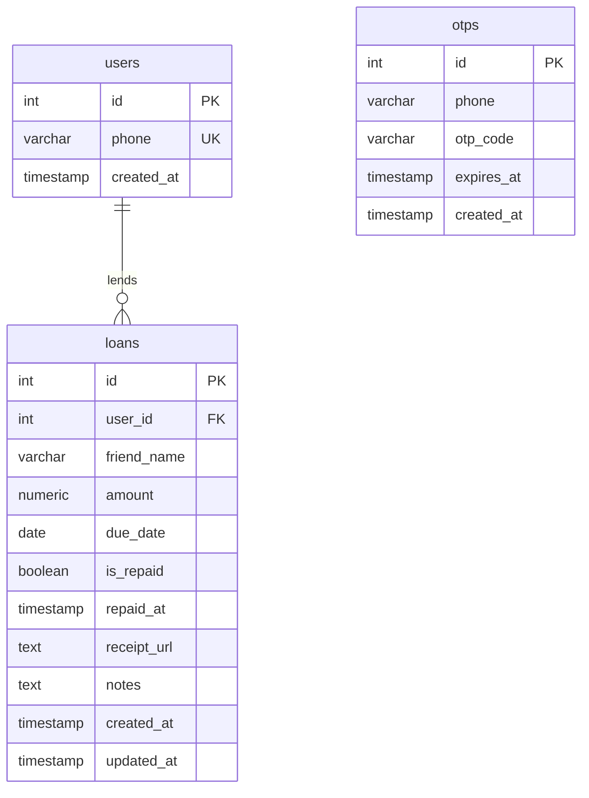

# 📒 MiniLedger — Full Stack Loan & Expense Tracker

> **MiniLedger** is a full-stack mobile & web application built to track money lent to friends, manage due dates, highlight overdue loans, and maintain an accurate financial ledger with receipt attachments.

Built with **Node.js + TypeScript + PostgreSQL** (Backend) and **React Native / Expo** (Cross-Platform Mobile & Web App).

---

## 🌟 Highlights & Key Features

### 🔒 Authentication & Security
- **Phone Number Login with Mock OTP**: Enter your phone number, receive a 6-digit verification code printed directly to your server console logs, and log in securely.
- **Stateless JWT Authentication**: Secure Bearer tokens with 30-day validity and auto-session persistence.

### 💰 Financial Ledger & Loans Management
- **Add Loan Entry**: Record friend's name, loan amount, due date (with quick presets like `Tomorrow`, `+1 Week`, `+1 Month`), and optional notes.
- **Overdue Highlighting**: Any loan past its due date is prominently highlighted with an alert banner, countdown tag, and distinct visual styling.
- **Repayment Tracking**: Mark loans as repaid with a single tap, with instant optimistic UI feedback and undo capability.
- **Financial Summary Card**: Real-time overview at the top displaying:
  - **Total Lent**
  - **Total Repaid** (Settled amount)
  - **Overdue Amount** (Warning badge when overdue loans exist)
  - Pending, Overdue, and Settled count metrics
- **Filters & Search**: Filter by `All`, `Overdue`, `Pending`, or `Settled`, with instant search by friend's name.

### 🎁 Bonus Features
- **📸 Receipt Photo Upload**: Attach a photo of a receipt or bill when adding an entry (supports gallery selection and camera capture via `expo-image-picker` & `multer`).
- **🛡️ Strict Input Validation**: Powered by `Zod` for phone numbers, 6-digit OTPs, positive amounts, and ISO dates.
- **🧪 Comprehensive Test Suite**: 13 automated unit and integration tests using **Jest + Supertest** covering auth flows, validations, CRUD operations, and summary calculations.
- **⚡ Zero-Config Instant Execution**: Dual-mode database engine! Connects to live PostgreSQL (`DATABASE_URL`), and automatically falls back to an in-memory PostgreSQL engine (`pg-mem`) if PostgreSQL is not currently running locally.

---

## 🏗️ Architecture & Technology Stack

| Layer | Technologies Used |
| :--- | :--- |
| **Backend** | Node.js, TypeScript, Express.js, PostgreSQL (`pg`), JWT, Zod, Multer |
| **Database** | PostgreSQL 15+ (with automatic `pg-mem` in-memory fallback for instant evaluation) |
| **Mobile App** | React Native, Expo SDK 52, TypeScript, AsyncStorage, Expo Image Picker, Vector Icons |
| **Testing** | Jest, Supertest, ts-jest |

```
miniledger/
├── backend/
│   ├── src/
│   │   ├── config/database.ts        # PostgreSQL connection pool & pg-mem fallback
│   │   ├── controllers/              # Auth, Loan, and Upload controllers
│   │   ├── middleware/               # JWT authentication & error handling
│   │   ├── models/schema.sql         # Database schema & indexes
│   │   ├── routes/                   # Modular Express routes
│   │   ├── services/                 # Business logic (AuthService, LoanService)
│   │   ├── utils/validation.ts       # Zod schemas
│   │   ├── app.ts                    # Express app configuration
│   │   └── server.ts                 # Server entrypoint
│   ├── tests/                        # 13 Jest unit/integration tests
│   └── uploads/                      # Static storage for receipt images
│
├── mobile/                           # React Native Expo app
│   ├── src/
│   │   ├── api/client.ts             # API client & upload handler
│   │   ├── components/               # SummaryCard, LoanCard, AddLoanModal, etc.
│   │   ├── context/AuthContext.tsx   # Auth state management
│   │   ├── screens/                  # LoginScreen & DashboardScreen
│   │   ├── theme/colors.ts           # Fintech-inspired theme palette
│   │   └── utils/formatters.ts       # Currency & date formatters
│   ├── App.tsx
│   └── app.json
│
├── docker-compose.yml                # Optional 1-command PostgreSQL database
└── README.md
```

---

## 🗄️ Database Schema



---

## 🚀 Quick Start Guide

### Prerequisites
- **Node.js** (v18 or higher recommended)
- **npm** or **yarn**

---

### Step 1: Start the Backend Server

```bash
cd backend
npm install
npm run dev
```

> **Note on PostgreSQL**: 
> - If you have a PostgreSQL server running, configure `DATABASE_URL` in `backend/.env` (or run `docker compose up -d` in the root folder).
> - If you **do not** have PostgreSQL installed, MiniLedger will **automatically** start with its built-in in-memory PostgreSQL engine (`pg-mem`) so you can run and test everything immediately without installing anything!

The backend will start at `http://localhost:4000`:
- Health check: `http://localhost:4000/api/health`

---

### Step 2: Start the Mobile App

Open a new terminal window:

```bash
cd mobile
npm install
npm run web
```

- **In Browser (Fastest & Recommended)**: Press `w` or open `http://localhost:8081` in Chrome.
- **On Physical Android/iOS Device**: Install the **Expo Go** app from Google Play or App Store, run `npx expo start`, and scan the QR code with your phone camera or Expo Go.
- **On Android Emulator**: Run `npm run android` or press `a` in the terminal.

---

## 🧪 Running Automated Tests

Run the test suite in the backend directory:

```bash
cd backend
npm test
```

### Test Coverage Summary:
- ✅ Rejection of invalid phone numbers
- ✅ Mock OTP generation and console logging
- ✅ Rejection of incorrect OTPs
- ✅ OTP verification and JWT issuance
- ✅ Authenticated user retrieval (`/api/auth/me`)
- ✅ Unauthorized request rejection
- ✅ Input validation on loan creation (negative amounts, missing fields, malformed dates)
- ✅ Creation of normal and overdue loan entries
- ✅ Loan listing with dynamic `is_overdue` calculation
- ✅ Filtering loans by status (Overdue, Pending, Settled)
- ✅ Accurate financial summary: `totalLent`, `totalRepaid`, and `overdueAmount`
- ✅ Loan repayment status toggle and immediate summary update

---

## 📡 API Reference

### 1. Authentication

#### `POST /api/auth/send-otp`
Generates a mock OTP, stores it with 5-minute expiry, and prints it in the backend terminal logs.
```json
// Request Body
{
  "phone": "+15550192834"
}

// Response (200 OK)
{
  "success": true,
  "message": "OTP sent successfully. Check your server console for the code.",
  "mockOtp": "555318"
}
```

#### `POST /api/auth/verify-otp`
Verifies OTP code, finds or creates user, and returns a JWT Bearer token.
```json
// Request Body
{
  "phone": "+15550192834",
  "otp": "555318"
}

// Response (200 OK)
{
  "success": true,
  "message": "Authentication successful.",
  "token": "eyJhbGciOiJIUzI1NiIs...",
  "user": {
    "id": 1,
    "phone": "+15550192834",
    "created_at": "2026-10-23T15:20:00Z"
  }
}
```

#### `GET /api/auth/me`
Returns currently authenticated user profile (Requires `Authorization: Bearer <token>`).

---

### 2. Loans & Summary

*All endpoints below require header: `Authorization: Bearer <token>`.*

#### `GET /api/loans/summary`
Returns total lent, total repaid, overdue amount, and status counts.
```json
// Response (200 OK)
{
  "success": true,
  "data": {
    "totalLent": 400.00,
    "totalRepaid": 250.00,
    "overdueAmount": 150.00,
    "pendingAmount": 150.00,
    "totalCount": 2,
    "repaidCount": 1,
    "pendingCount": 1,
    "overdueCount": 1
  }
}
```

#### `GET /api/loans`
List loan entries for authenticated user.
- Query parameters:
  - `filter`: `all` | `pending` | `repaid` | `overdue`
  - `search`: search by friend name

#### `POST /api/loans`
Create a new loan entry.
```json
// Request Body
{
  "friendName": "Alex Smith",
  "amount": 150.00,
  "dueDate": "2026-11-15",
  "notes": "Dinner split and concert tickets",
  "receiptUrl": "/uploads/receipt-1234567.jpg"
}
```

#### `PATCH /api/loans/:id/repay`
Mark a loan as repaid.

#### `PUT /api/loans/:id/status`
Toggle loan repaid status (`{ "isRepaid": true | false }`).

#### `POST /api/loans/upload-receipt` *(Bonus)*
Multipart form upload with field `receipt` (image file) returning the uploaded file's URL.

---

## 🎥 Screen Recording Walkthrough Guide (2–3 Minutes)

Here is a recommended script for your Loom or Google Drive screen recording:

1. **Terminal View (0:00 - 0:30)**:
   - Show `npm run dev` starting the backend server on `http://localhost:4000`.
   - Run `npm test` to demonstrate the passing automated test suite (13/13 tests).
2. **Login & OTP Flow (0:30 - 1:00)**:
   - Open the app in browser or emulator.
   - Enter your phone number and click **Send Mock OTP**.
   - Point out the OTP generated and logged in the backend terminal console: `[MOCK OTP] Phone: +1... | Code: 123456`.
   - Enter the 6-digit code and verify login.
3. **Ledger Dashboard & Summary Card (1:00 - 1:30)**:
   - Highlight the top **Ledger Overview card**: Total Lent, Repaid, and Overdue Amount.
   - Show how overdue entries have prominent red warning badges and border highlights.
4. **Adding a Loan Entry & Photo Upload (1:30 - 2:00)**:
   - Tap **+ Lend Money**.
   - Enter friend name, amount (e.g. $75), pick a due date.
   - Attach a receipt photo using the picker.
   - Submit and show the immediate addition to the ledger.
5. **Marking as Repaid & Instant Summary Update (2:00 - 2:30)**:
   - Click **Mark as Repaid** on an active loan.
   - Notice the optimistic status change to "Settled" and the real-time recalculation of **Total Repaid** and **Overdue Amount** in the summary card.
   - Demonstrate the filter tabs (`Overdue`, `Pending`, `Settled`) and the search bar.

---

## 💡 Code Explanation & Interview Readiness

Be prepared to explain:
1. **How Mock OTP works**: A 6-digit cryptographic pseudo-random integer is stored with an expiration timestamp and printed via `console.log`. Upon verification, the code is matched, marked as used, and an HMAC-SHA256 JWT is signed with the user ID.
2. **How Overdue logic is computed**: In `LoanService`, a loan is marked `is_overdue = !loan.is_repaid && loan.due_date < CURRENT_DATE`. The summary endpoint computes aggregates dynamically to ensure consistency.
3. **Database Layer**: Separation of concerns between Controller -> Service -> Database layer (`query()` abstraction). Supports both production PostgreSQL connection pooling and test/demo in-memory database.
4. **React Native State Management**: Lightweight React Context (`AuthContext`) handling session tokens with `AsyncStorage`, combined with optimistic UI updates for instant interaction response.
